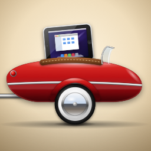

<p align="center"></p>

# Older Sidecar

Ukazuje obrazovku Macu na starém iPadu s jailbreakem přes USB. iPad může sloužit i jako touchpad
a ovladač pro Mac.

[English](README.md)

## Co je potřeba

- Mac s macOS 12.3 nebo novějším (Intel i Apple Silicon)
- iPad s jailbreakem a iOS 6 až 10 (iPad 2, 3, 4, iPad mini 1)
- USB kabel. Wi-Fi se nepoužívá.

## Instalace

**iPad:** v Cydii přidej zdroj `https://vp-of-tradelin.github.io/OlderSidecar/` a nainstaluj Older Sidecar.
Pokud máš jen AppSync, nainstaluj `OlderSidecar.ipa` z [Releases](https://github.com/VP-of-Tradelin/OlderSidecar/releases).

**Mac:**

1. Stáhni `OlderSidecar-1.7.0.dmg` z [Releases](https://github.com/VP-of-Tradelin/OlderSidecar/releases),
   otevři ho a přetáhni Older Sidecar do Aplikací.
2. Aplikace není ověřená Applem, takže ji macOS poprvé zablokuje. V Nastavení systému >
   Soukromí a zabezpečení klikni na Přesto otevřít.
3. Povol Nahrávání obrazovky a Zpřístupnění. Aplikace ukáže okno, které tě tím provede.

Běží v liště nahoře a spouští se po přihlášení. V jejím menu to jde vypnout.

## Používání

Připoj iPad kabelem a otevři na něm Older Sidecar. Vyber si jeden ze dvou režimů:

- **Jen obrazovka** - obraz Macu, nic se omylem neklikne. Dvěma prsty jde přiblížit.
- **Ovládat Mac** - z iPadu je touchpad s řadou kláves (esc, tab, ⌘⌥⌃⇧, šipky), klávesnice
  a tlačítka na jas, Mission Control, Launchpad, hudbu, hlasitost a zamčení. Obraz Macu se neukazuje.

V menu na Macu jde změnit rozlišení (režimy 4:3 vyplní celý iPad), je tam baterie iPadu a volba jazyka.
Jazyků je 14; překlady zatím nekontroloval rodilý mluvčí, opravy jsou vítané.

Když Mac usne, iPad to napíše a nezamrzne.

## Sestavení

Potřebuje Command Line Tools (`xcode-select --install`) a dpkg (`brew install dpkg`).

```
./build.sh
```

- `mac/` - aplikace pro Mac, výstup `dist/OlderSidecar-<verze>.dmg`
- `ios/` - aplikace pro iPad (armv7, iOS 6+), výstup `dist/OlderSidecar.ipa`. Poprvé si stáhne
  `iPhoneOS10.3.sdk` z [theos/sdks](https://github.com/theos/sdks).
- `cydia/` - balíček .deb a Cydia repo v `docs/` (zveřejňuje GitHub Pages)
- `tools/make-graphics.swift` - kreslí ikonu a textury

Mac s iPadem mluví přes usbmuxd na portu 7777 a posílá snímky JPEG zachycené přes ScreenCaptureKit.

## Licence

MIT. Sidecar je ochranná známka Apple Inc. Tento projekt s Applem nemá nic společného.
