
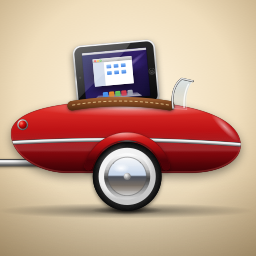

# Older Sidecar

Propojí starý iPad nebo iPhone s jailbreakem s dnešním Macem přes USB. iPad umí ukazovat obrazovku Macu a oba můžou
sloužit jako touchpad a ovladač, nebo jako Dock s velkými tlačítky (trochu jako Stream Deck).

[English](README.md)

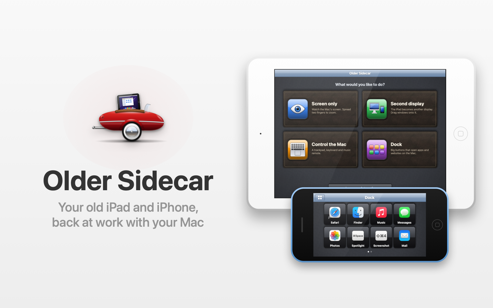

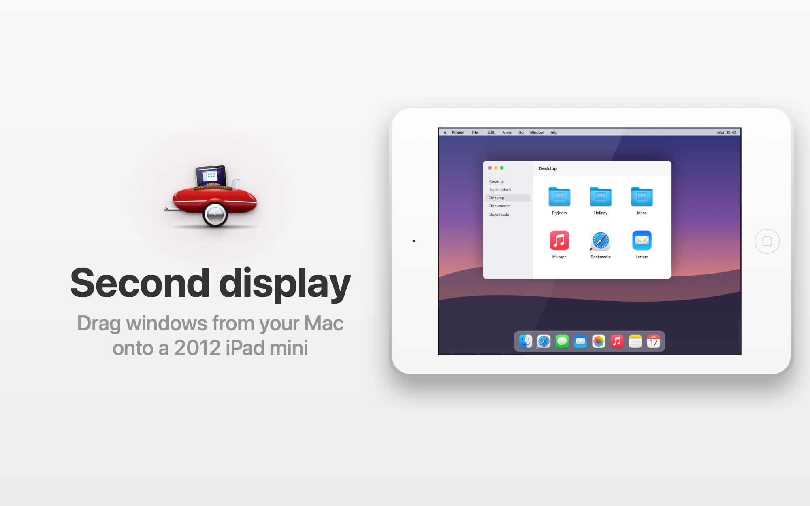
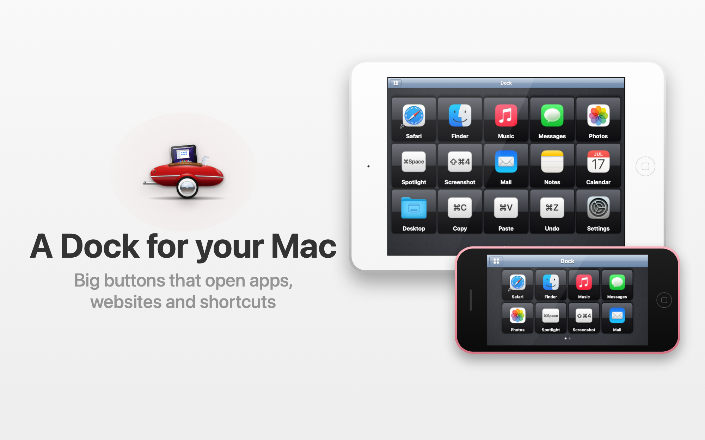
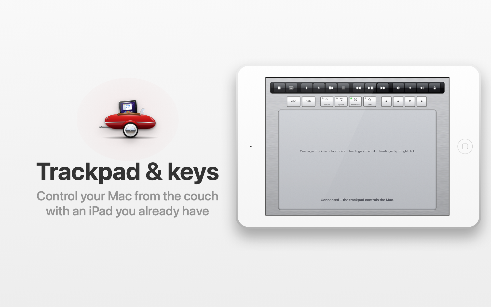
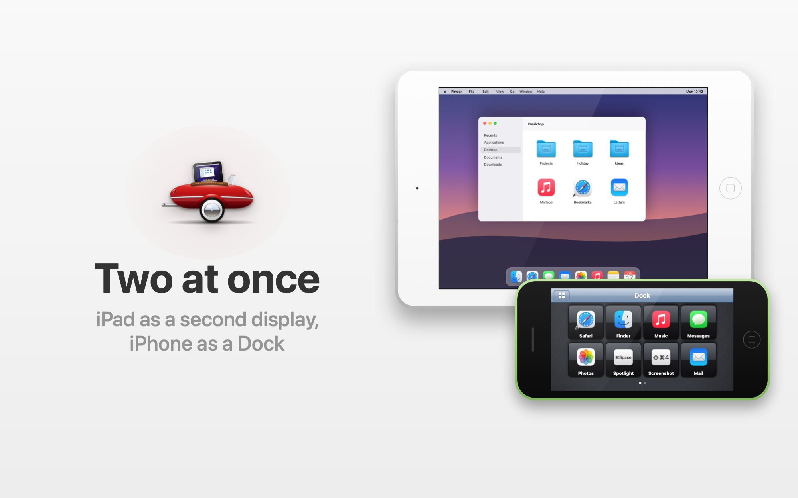
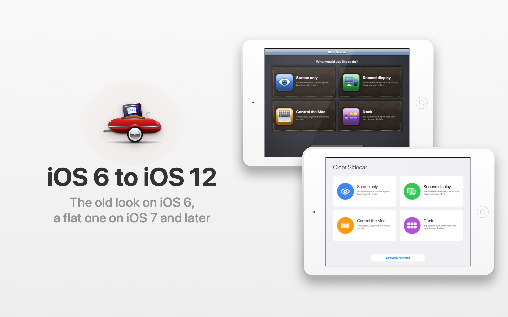

## Windows

Existuje i verze pro Windows 10 a 11. V Cydii přidej zdroj `https://oldersidecar.github.io/OlderSidecar/windows/` (iOS 7+; na iOS 6 `http://oldersidecar-windows.surge.sh/`) a nainstaluj **Older Sidecar (Windows)**.

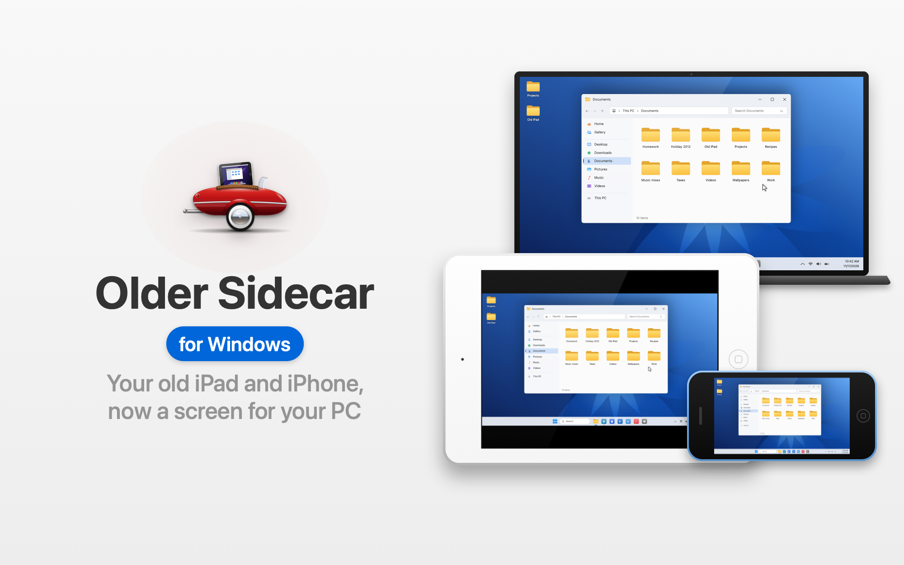
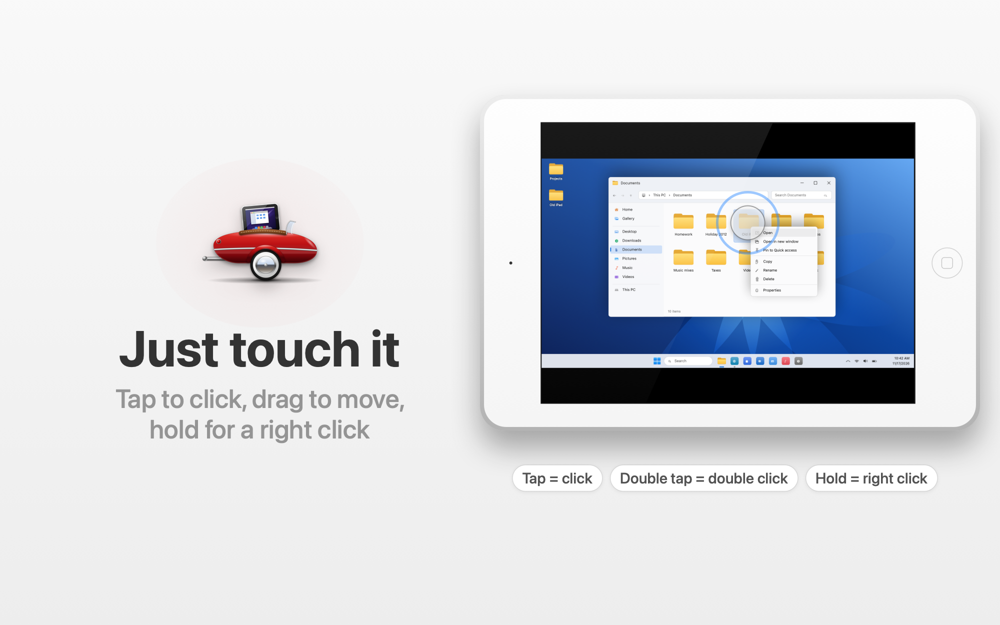
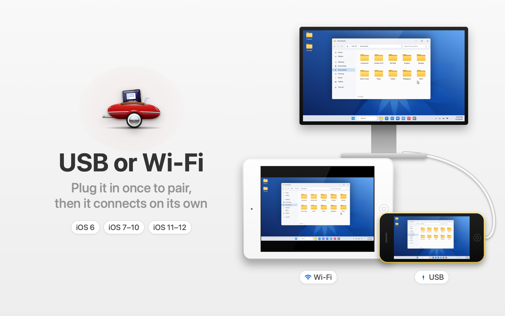
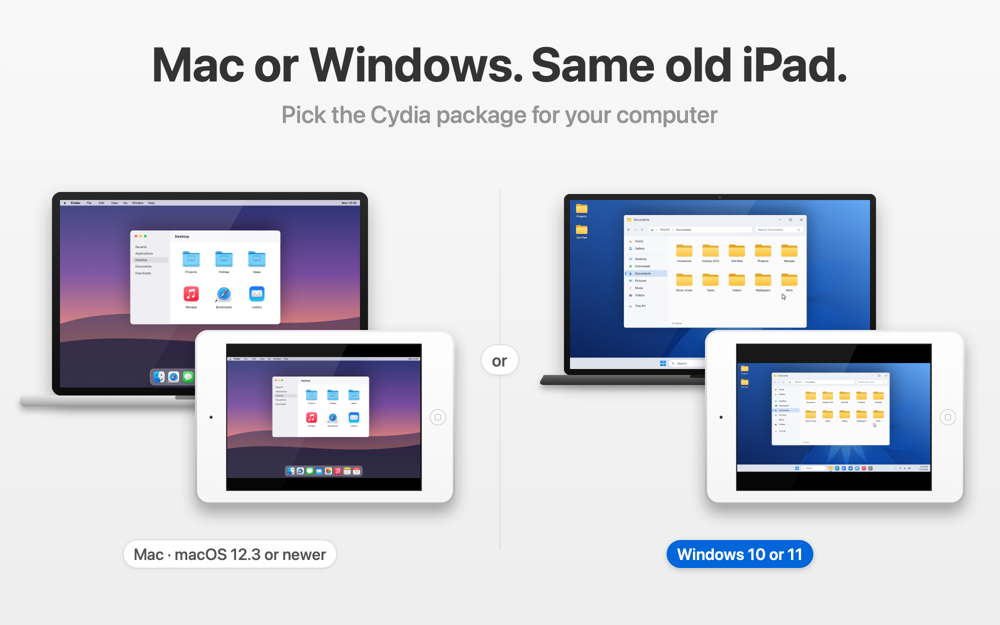

## Co je potřeba

- Mac s macOS 12.3 nebo novějším (Intel i Apple Silicon)
- iPad nebo iPhone s jailbreakem a iOS 6 až 12 (iPad 2, 3, 4, iPad mini, iPad Air, iPhone 4S, 5, 5c, 5s, 6, …)
- USB kabel. Jde to i přes Wi-Fi, jakmile bylo zařízení jednou připojené kabelem (kabel je rychlejší).

## Instalace

**iPad / iPhone:** v Cydii přidej zdroj `http://oldersidecar.surge.sh/` (s http, ne https, jinak se k němu iOS 6 nedostane).
Na iOS 6 nainstaluj **Older Sidecar**, na novějších zařízeních **Older Sidecar (iOS 7–10)** nebo **Older Sidecar (iOS 11–12)**.
Pokud máš jen AppSync, nainstaluj `OlderSidecar-iOS6.ipa`, `OlderSidecar-iOS7-10.ipa` nebo `OlderSidecar-iOS11-12.ipa` z [Releases](https://github.com/Oldersidecar/OlderSidecar/releases).

**Mac:**

1. Stáhni `OlderSidecar-1.12.1.dmg` z [Releases](https://github.com/Oldersidecar/OlderSidecar/releases),
   otevři ho a přetáhni Older Sidecar do Aplikací.
2. Aplikace není ověřená Applem, takže ji macOS poprvé zablokuje. V Nastavení systému >
   Soukromí a zabezpečení klikni na Přesto otevřít.
3. Povol Nahrávání obrazovky a Zpřístupnění. Aplikace ukáže okno, které tě tím provede.

Běží v liště nahoře a spouští se po přihlášení. V jejím menu to jde vypnout.

## Používání

Připoj iPad nebo iPhone kabelem a otevři na něm Older Sidecar. Vyber si režim:

- **Jen obrazovka** - obraz Macu. Ťuknutí klikne, tah táhne, podržení je pravý klik, dvěma prsty jde přiblížit.
- **Druhý monitor** (iPad) - z iPadu je další monitor Macu vedle hlavního. Přetáhneš na něj okna. Kde leží,
  nastavíš v Nastavení systému > Monitory. Rozlišení je v menu Older Sidecar (Rozlišení druhého monitoru):
  větší znamená víc místa a menší písmo.
- **Ovládat Mac** - z iPadu nebo iPhonu je touchpad s řadou kláves (esc, tab, ⌘⌥⌃⇧, šipky), klávesnice
  a tlačítka na jas, Mission Control, Launchpad, hudbu, hlasitost a zamčení. Obraz Macu se neukazuje.
- **Dock** - mřížka velkých tlačítek. Každé na Macu otevře appku, web nebo složku, nebo stiskne klávesovou
  zkratku. Nastavují se na Macu v menu: Older Sidecar → Dock….

Na iPhonu režimy s obrazem nejsou, jen Ovládat Mac a Dock.

Zařízení můžeš připojit víc najednou a každé má svůj režim, třeba iPhone jako Dock a iPad jako druhý monitor.

V menu na Macu je každé zařízení i s baterií. V Nastavení… je rozlišení (režimy 4:3 vyplní celý iPad), dotyk
v obraze, Wi-Fi, ostřejší obraz na Retina iPadech, sdílení schránky, spouštění po přihlášení, jazyk a denní kontrolu nové verze (jen se zeptá GitHubu na číslo poslední verze).
Jazyků je 14; překlady zatím nekontroloval rodilý mluvčí, opravy jsou vítané.

Text zkopírovaný na Macu vložíš na iPadu nebo iPhonu a naopak (Sdílet schránku v Nastavení na Macu).
Appka se otevře v režimu, který jsi použil naposledy.

Když Mac usne, iPad nebo iPhone to napíše a nezamrzne.

## Licence

Zdarma ke stažení, používání a sdílení v původní podobě. Zdrojový kód není veřejný.
Viz [LICENSE](LICENSE). Sidecar je ochranná známka Apple Inc. Tento projekt s Applem nemá nic společného.
