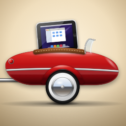
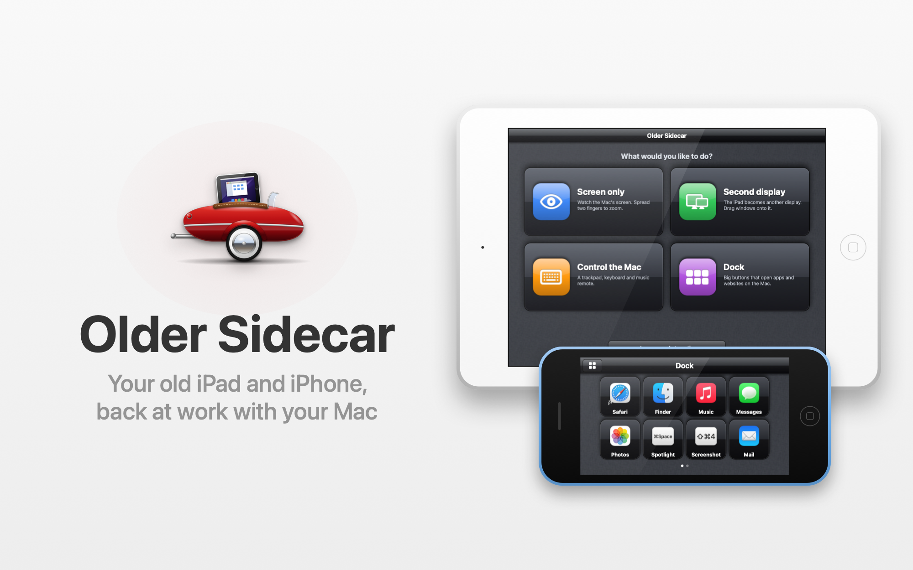
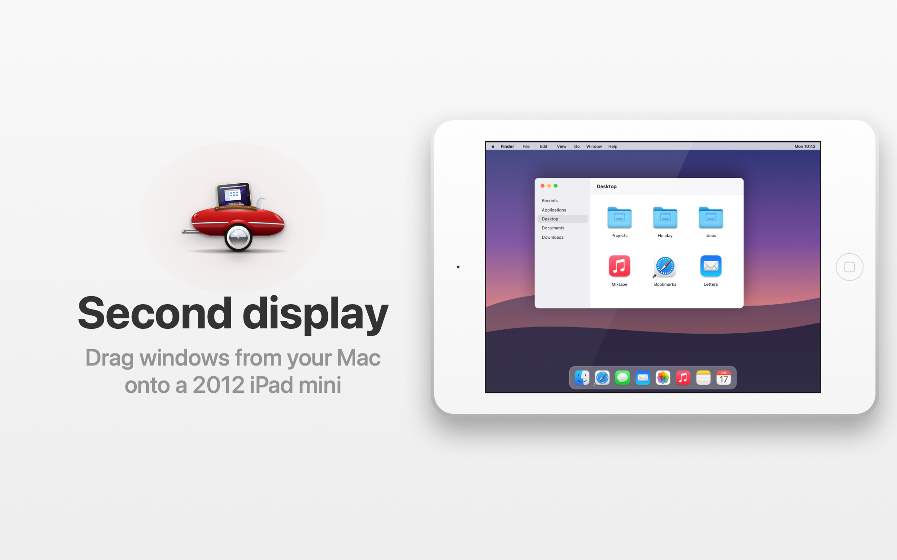
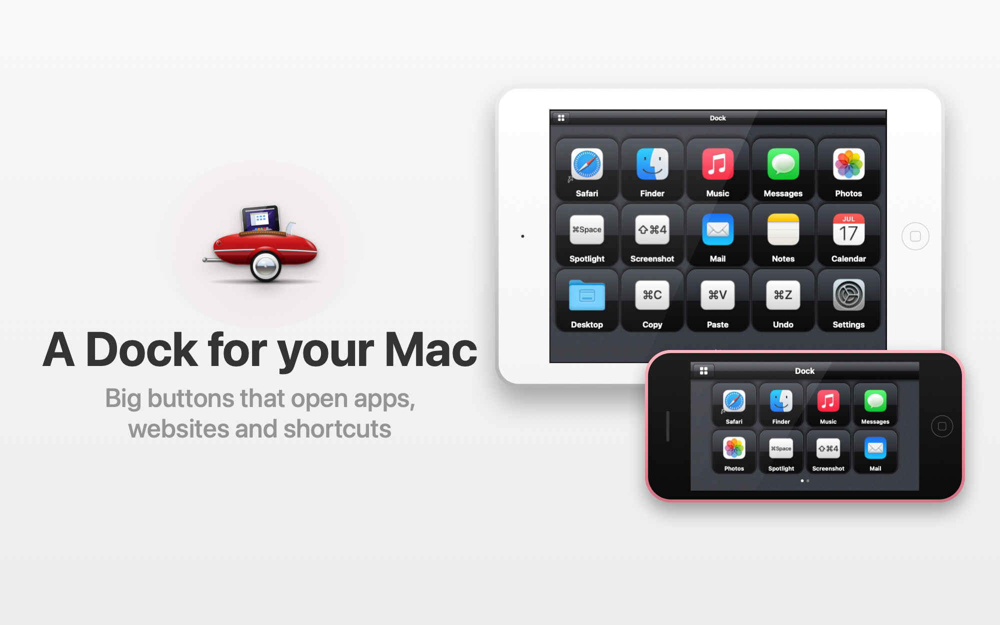
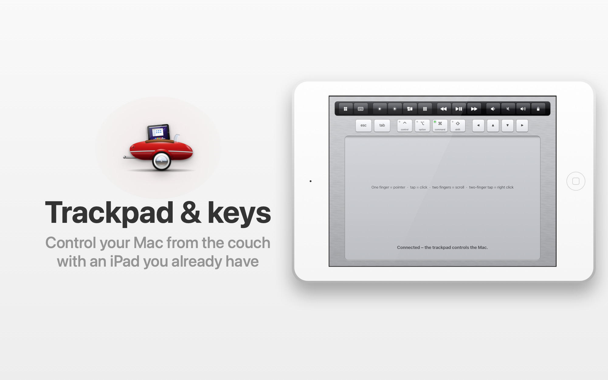
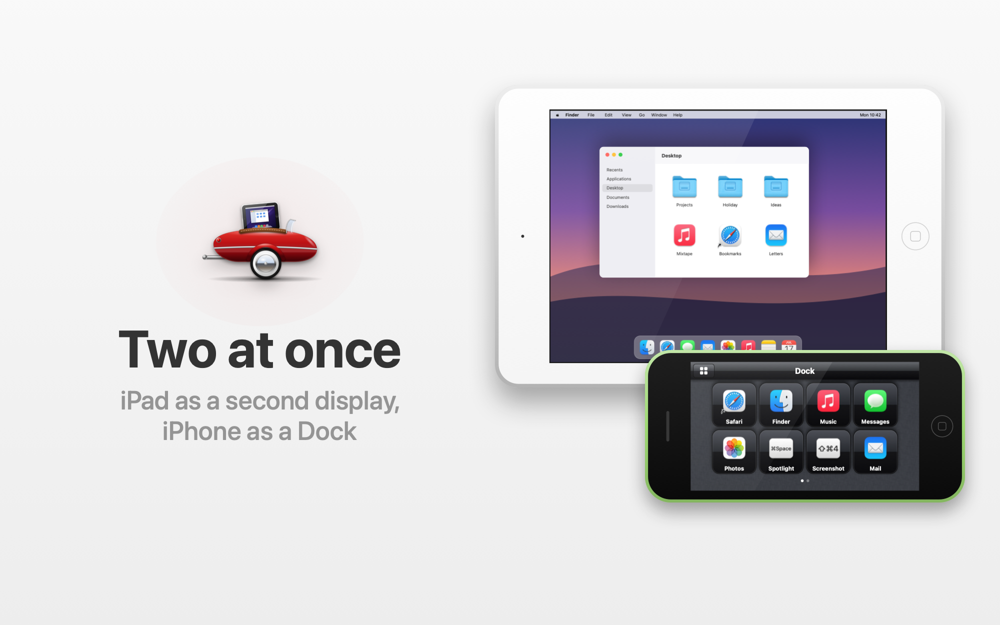
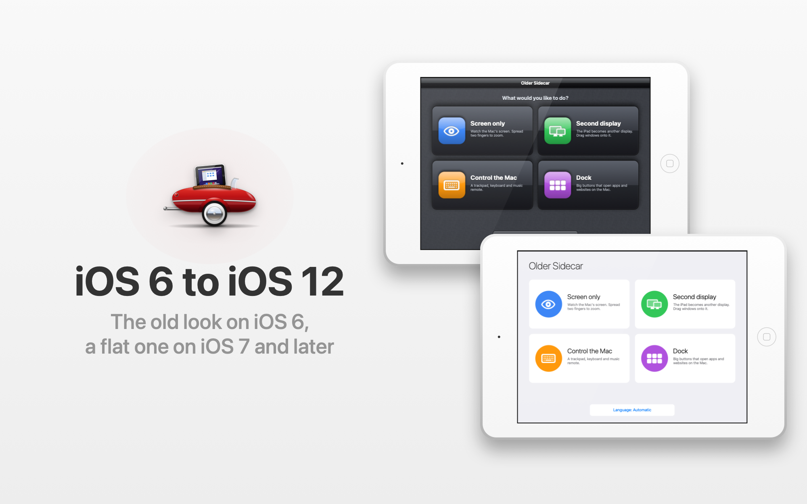

# Older Sidecar

Connects an old jailbroken iPad or iPhone to a modern Mac over USB. The iPad can show the Mac's screen, and both
can work as a trackpad and remote or as a Dock of big buttons (a bit like a Stream Deck).

[Česky](README.cs.md)

## Requirements

- Mac with macOS 12.3 or later (Intel or Apple Silicon)
- Jailbroken iPad or iPhone on iOS 6 to 12 (iPad 2, 3, 4, iPad mini, iPad Air, iPhone 4S, 5, 5c, 5s, 6, …)
- USB cable. Wi-Fi is not used.

## Install

**iPad / iPhone:** add `http://oldersidecar.surge.sh/` as a source in Cydia (with http, not https, so that iOS 6 can reach it).
Install **Older Sidecar** on iOS 6, **Older Sidecar (iOS 7–10)** or **Older Sidecar (iOS 11–12)** on newer devices.
If you only have AppSync, install `OlderSidecar-iOS6.ipa`, `OlderSidecar-iOS7-10.ipa` or `OlderSidecar-iOS11-12.ipa` from [Releases](https://github.com/Oldersidecar/OlderSidecar/releases).

**Mac:**

1. Download `OlderSidecar-1.11.0.dmg` from [Releases](https://github.com/Oldersidecar/OlderSidecar/releases),
   open it and drag Older Sidecar to Applications.
2. The app is not notarized by Apple, so macOS blocks it the first time. Go to
   System Settings > Privacy & Security and click Open Anyway.
3. Allow Screen Recording and Accessibility. The app shows a setup window that walks you through it.

It runs in the menu bar and starts at login. You can turn that off in its menu.

## Use

Plug in the iPad or iPhone and open Older Sidecar on it. Pick a mode:

- **Screen only** - the Mac screen, nothing gets clicked by accident. Pinch to zoom.
- **Second display** (iPad) - the iPad becomes an extra display for the Mac, next to your main one. Drag windows
  onto it. You can arrange it in System Settings > Displays.
- **Control Mac** - the iPad or iPhone becomes a trackpad with a row of keys (esc, tab, ⌘⌥⌃⇧, arrows), a keyboard
  and buttons for brightness, Mission Control, Launchpad, music, volume and lock. The Mac screen is not shown.
- **Dock** - a grid of big buttons. Each one opens an app, a website or a folder on the Mac, or presses a keyboard
  shortcut. You set them up on the Mac in the menu: Older Sidecar → Dock….

On the iPhone there are no screen modes, only Control Mac and Dock.

You can plug in several devices at once and each one has its own mode, for example an iPhone as the Dock
and an iPad as a second display.

The Mac menu has a resolution picker (4:3 modes fill the whole iPad), shows the device's battery, and lets you
change the language. 14 languages are included; the translations were not checked by native speakers yet,
fixes are welcome.

Copy text on the Mac and paste it on the iPad or iPhone, or the other way round (Share Clipboard in the Mac menu).
The app opens in the mode you used last time.

When the Mac sleeps, the iPad or iPhone says so instead of freezing.

## License

Free to download, use and share in its original form. The source code is not public.
See [LICENSE](LICENSE). Sidecar is a trademark of Apple Inc. This project has nothing to do with Apple.
